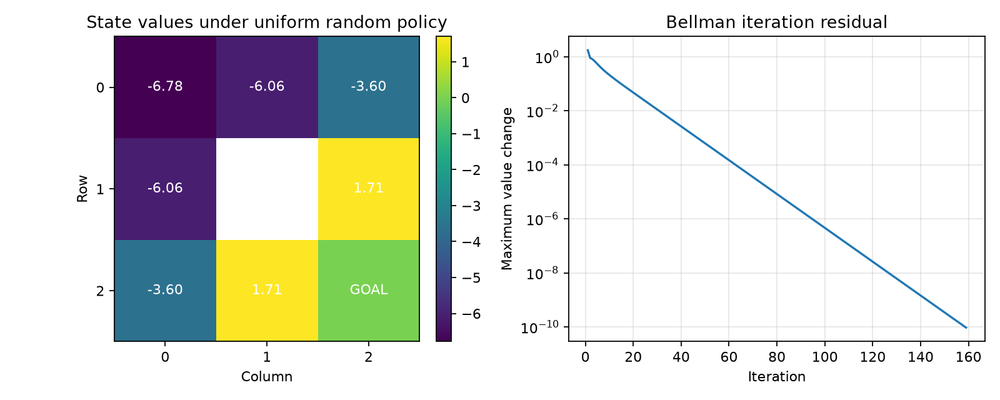

# 第 2 章实验记录：GridWorld 环境建模与固定策略评估

## 实验 1：GridWorld 的贝尔曼期望方程与状态价值计算

**代码文件：** `01_gridworld_policy_evaluation.py`  
**结果图片：** `figures/01_gridworld_policy_evaluation.png`

### 一、实验目标

1. 使用 Python 建立一个简单的马尔可夫决策过程（Markov Decision Process, MDP），明确状态、动作、转移、奖励与终止条件。
2. 在**给定均匀随机策略**的条件下，使用贝尔曼期望方程迭代计算状态价值函数 $V^\pi(s)$。
3. 将数学公式与代码中的 `step()`、动作价值备份、策略求期望和同步更新逐项对应。
4. 利用状态价值热力图和迭代变化曲线，分析随机策略的行为以及算法收敛情况。

### 二、实验内容

#### 2.1 环境设置

构建 $3\times3$ 的 GridWorld，左上角坐标为 `(0, 0)`，位置按 `(row, col)` 表示：

| 行/列 | 0 | 1 | 2 |
|---|---|---|---|
| 0 | 起点 `(0,0)` | `(0,1)` | `(0,2)` |
| 1 | `(1,0)` | 障碍 `(1,1)` | `(1,2)` |
| 2 | `(2,0)` | `(2,1)` | 终点 `(2,2)` |

具体规则如下：

| 项目 | 设置 |
|---|---|
| 动作集合 | 上、下、左、右 |
| 固定策略 | 每个普通状态下四个动作等概率，$\pi(a\mid s)=1/4$ |
| 转移方式 | 确定性转移；遇到障碍或越界时保持原状态 |
| 普通移动奖励 | $-1$ |
| 撞障碍或越界奖励 | $-1$，仍消耗一个时间步 |
| 进入终点奖励 | $+10$，并立即结束回合 |
| 终点后续价值 | $V^\pi(G)=0$ |
| 折扣因子 | $\gamma=0.9$ |
| 价值初始化 | $V_0(s)=0$ |
| 停止阈值 | $\theta=10^{-10}$ |
| 最大迭代次数 | 10000 |

**奖励规则说明：** 每次普通移动和无效动作都记为 $-1$，是本实验人为设定的时间步成本，并非 GridWorld 的统一规定。终点的后续价值为 0，不等于没有到达奖励；$+10$ 在进入终点的那一步计入回报。

#### 2.2 固定策略的状态价值评估

状态价值函数表示从状态 $s$ 出发、之后始终遵循策略 $\pi$ 时的期望累计折扣回报：

$$
V^\pi(s)=\mathbb E_\pi[G_t\mid S_t=s].
$$

沿用本章的奖励时间索引，即动作 $A_t$ 执行后获得 $R_t$，满足 $G_t=R_t+\gamma G_{t+1}$。

固定策略下的同步贝尔曼更新为：

$$
V_{k+1}(s)=\sum_a\pi(a\mid s)\sum_{s'}p(s'\mid s,a)
\left[r(s,a,s')+\gamma V_k(s')\right].
$$

本实验的状态转移为确定性，四个动作又等概率，因此简化为：

$$
\boxed{V_{k+1}(s)=\frac14\sum_{a\in\mathcal A}
\left[r(s,a,s'_a)+0.9V_k(s'_a)\right]}
$$

其中 $s'_a$ 是在状态 $s$ 执行动作 $a$ 后的实际下一状态。

对应代码的主要步骤为：

```python
next_state, reward, _ = step(state, action)
q = reward + GAMMA * values[next_state]
action_values.append(q)
new_values[state] = np.mean(action_values)
```

`q` 在这里是基于旧价值估计的一步贝尔曼备份值，**不是已经求得的精确动作价值函数**。`np.mean()` 用来计算均匀随机策略下四个动作的期望；如果更换为非均匀策略，应改为按策略概率加权。代码将 `values` 与 `new_values` 分开，确保本轮所有状态都读取上一轮估计，实现同步更新。

收敛时监控相邻两轮的最大变化量：

$$
\Delta_k=\max_s\left|V_{k+1}(s)-V_k(s)\right|.
$$

当 $\Delta_k<10^{-10}$ 时停止迭代。该指标用于判断数值更新是否趋于稳定，**不是直接测量相对于真实价值的误差**。

### 三、实验结果与分析

#### 3.1 实际运行结果

使用原始实验代码运行，得到：

- **收敛迭代轮数：** 159 次。
- **最后一轮最大价值变化量：** $9.362\times10^{-11}$。
- **最终状态价值矩阵：**

```text
[[-6.7801 -6.0646 -3.6000]
 [-6.0646     nan  1.7091]
 [-3.6000  1.7091  0.0000]]
```

其中 `nan` 表示不可进入的障碍位置；终点显示的 0 是终止后的后续价值，而非进入终点的即时奖励。



#### 3.2 状态价值热力图分析

1. **起点 `(0,0)` 价值最低，约为 $-6.7801$。** 均匀随机策略在该位置有一半概率尝试向上或向左，结果是原地不动并损失 1；即使移动成功，也可能反复绕路，因此未来的折扣累计回报为负。
2. **靠近终点的 `(1,2)` 和 `(2,1)` 价值约为 $1.7091$。** 从这两个位置有四分之一的概率一步进入终点，直接取得 $+10$；但其余动作可能越界、撞障碍或者远离终点，所以价值并不是 10。
3. **相同几何位置关系的格子具有相同价值。** 例如 `(0,1)` 与 `(1,0)` 都约为 $-6.0646$；`(0,2)` 与 `(2,0)` 都约为 $-3.6000$。这是因为本环境布局、动作概率和奖励规则关于主对角线对称。
4. **这些数值属于固定随机策略下的 $V^\pi$，不是 $V^*$。** 当前实验是在评估策略，而不是求最优路径或最优策略。

#### 3.3 贝尔曼方程手算验证

**示例 A：状态 `(1,2)`。** 设该状态价值为 $x$，右上角 `(0,2)` 的价值为 $y$。四个动作依次为：上移到 `(0,2)` 奖励 $-1$；下移至终点奖励 $+10$；左撞障碍和右越界均留在原地、奖励 $-1$。

因此：

$$
\begin{aligned}
x&=\frac14\Big[(-1+0.9y)+10\\
&\qquad+(-1+0.9x)+(-1+0.9x)\Big],\\
4x&=7+0.9y+1.8x,\\
2.2x&=7+0.9y.
\end{aligned}
$$

代入实验中 $y\approx-3.6000$：

$$
\boxed{x\approx\frac{7-3.24}{2.2}=1.7091.}
$$

**示例 B：起点 `(0,0)`。** 设起点价值为 $z$；向上、向左都会原地不动；向下到 `(1,0)`，向右到 `(0,1)`，四个动作即时奖励均为 $-1$：

$$
\begin{aligned}
z=\frac14\Big[&(-1+0.9z)+(-1+0.9z)\\
&+(-1+0.9V^\pi(1,0))\\
&+(-1+0.9V^\pi(0,1))\Big].
\end{aligned}
$$

整理：

$$
2.2z=-4+0.9V^\pi(1,0)+0.9V^\pi(0,1).
$$

代入两处状态价值均约为 $-6.0646$：

$$
\boxed{z\approx\frac{-4+1.8(-6.0646)}{2.2}=-6.7801.}
$$

**示例 C：右上角 `(0,2)`。** 设它的价值为 $y$。向上和向右越界并留在原地，向下到 `(1,2)`，向左到 `(0,1)`，每个动作即时奖励都是 $-1$：

$$
\begin{aligned}
y=\frac14\Big[&(-1+0.9y)+(-1+0.9V^\pi(1,2))\\
&+(-1+0.9V^\pi(0,1))+(-1+0.9y)\Big].
\end{aligned}
$$

整理后：

$$
2.2y=-4+0.9V^\pi(1,2)+0.9V^\pi(0,1).
$$

代入 $1.7091$ 和 $-6.0646$：

$$
\boxed{y\approx\frac{-4+0.9(1.7091)-0.9(6.0646)}{2.2}=-3.6000.}
$$

这些手算是**代入程序求得的其他状态价值，对贝尔曼方程进行数值验证**；不是从零独立求解整个网格。如果需要完整解析求解，应对七个普通状态建立联立方程，或者像程序一样迭代求解。

#### 3.4 收敛曲线分析

右侧曲线展示每轮最大价值变化量 $\Delta_k$，纵轴采用对数尺度。实验中曲线总体持续下降，最终在第 159 轮低于 $10^{-10}$，说明同步贝尔曼更新逐渐趋于稳定。

本实验存在原地不动及状态之间的循环依赖，不能只按照网格距离从终点向起点一次性倒推。迭代过程通过旧价值估计不断更新新价值，逐步将不同路径上的即时奖励和后续价值纳入计算。第 $k$ 轮估计可以升高或降低，并不保证逐轮单调逼近最终值。

159 次是**当前环境、随机策略、$\gamma=0.9$、零初始化与阈值 $10^{-10}$** 下的实际结果，不是 GridWorld 的固定迭代次数。

### 四、实验结论

1. 使用确定性状态转移模型、奖励函数和均匀随机策略，可以直接通过贝尔曼期望方程计算固定策略下的状态价值，无需在环境中实际采样大量轨迹。
2. **状态价值衡量长期期望回报，而非当前格子的即时奖励。** 因此起点价值可能为负，终点本身的后续价值也可以为 0。
3. 在有障碍、越界和自循环的 GridWorld 中，状态价值存在相互依赖；同步贝尔曼迭代能够逐步求得稳定解。
4. 数学上的动作价值备份 `reward + gamma * V_old[next_state]`，对应代码中的 `q`；对四个动作等概率求平均，对应 `np.mean(action_values)`。二者建立了贝尔曼期望方程和 Python 实现之间的直接联系。
5. 本实验完成的是**策略评估（Policy Evaluation）**。后续动态规划将进一步学习如何通过策略改进、策略迭代和价值迭代寻找最优策略。
